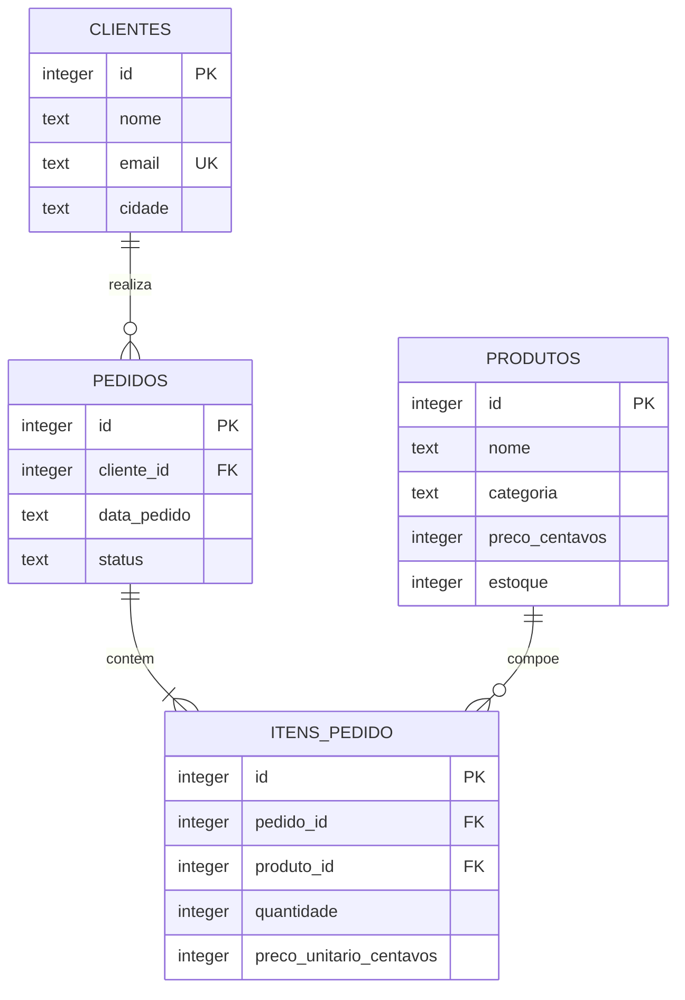

# Mini Loja Debiee | Papelaria em dados

Aplicação de terminal para analisar as vendas de uma papelaria fictícia,
usando **Python, SQL e SQLite**. Inclui cadastro de produtos, registro de
pedidos com controle de estoque e seis relatórios exportáveis para CSV.

**Começando agora?** Abra [COMECAR_AQUI.pdf](COMECAR_AQUI.pdf).

## Problema e resultado

Uma pequena loja precisa saber quanto vendeu, quais produtos geram receita e
quais clientes ainda não têm compras concluídas. A aplicação integra um banco
relacional e consultas SQL em um menu simples, reproduzível localmente.

Na amostra inicial: **8 clientes, 8 produtos, 12 pedidos e 21 itens de pedido**.
Dos 12 pedidos, 8 estão concluídos, 2 pendentes e 2 cancelados.

| Indicador da amostra | Resultado |
| --- | ---: |
| Faturamento de pedidos concluídos | R$ 445,60 |
| Ticket médio por pedido concluído | R$ 55,70 |
| Unidades vendidas em pedidos concluídos | 36 |
| Clientes com compra concluída | 5 |

Todos os dados são fictícios. Os resultados mudam quando novos pedidos são registrados.

## Requisitos para executar

- Python **3.10 ou superior**, com o módulo padrão `sqlite3`.
- Terminal na pasta do projeto.
- Não é necessário instalar servidor de banco de dados ou pacotes externos.

Validado com Python 3.12.14 em Linux. O iniciador Windows acompanha o pacote;
o fluxo de terminal também foi testado com caminhos que contêm espaços.

### Windows

1. Extraia **toda** a pasta do ZIP antes de executar.
2. Abra a pasta `mini-loja-debiee`.
3. Dê dois cliques em **iniciar.bat**.

Ou abra o terminal nessa pasta e execute:

```powershell
py -3 -m src.main
```

Se o comando `py` não existir, tente `python -m src.main`. Se nenhum funcionar,
instale Python pelo site oficial: https://www.python.org/downloads/ .

### Linux e macOS

```bash
python3 -m src.main
```

### Ambiente virtual (opcional)

No Windows:

```powershell
py -3 -m venv .venv
.venv\Scripts\python.exe -m src.main
```

No Linux ou macOS:

```bash
python3 -m venv .venv
.venv/bin/python -m src.main
```

O banco `data/loja.db` é criado automaticamente na primeira execução.
As próximas execuções preservam seus cadastros e não duplicam a amostra.
O banco e os arquivos gerados não entram nos commits.

## Menu e relatórios

| Opção | Função |
| --- | --- |
| 1 | Resumo de vendas concluídas |
| 2 | Faturamento por cliente, incluindo clientes com total zero |
| 3 | Produtos por faturamento, incluindo produtos sem vendas |
| 4 | Evolução mensal do faturamento |
| 5 | Detalhes dos pedidos de todos os status |
| 6 | Clientes sem compras concluídas |
| 7 | Exportação de qualquer relatório para CSV |
| 8 | Cadastro de produto com preço e estoque |
| 9 | Registro de pedido para um dos clientes da amostra |
| 0 | Encerrar |

Os CSVs do menu ficam na pasta `saidas/`, com acentos em UTF-8, separador `;`
e valores monetários com vírgula decimal. No Excel, importe como CSV UTF-8,
com separador ponto e vírgula, caso o arquivo abra em uma única coluna.

### Execução sem menu

```powershell
py -3 -m src.main --relatorio resumo
py -3 -m src.main --relatorio produtos
py -3 -m src.main --relatorio mensal --exportar saidas/mensal.csv
```

Nomes válidos: `resumo`, `clientes`, `produtos`, `mensal`, `pedidos`, `sem_compras`.
A exportação não substitui um arquivo existente: escolha outro nome se necessário.

Para experimentar sem mexer no banco principal:

```powershell
py -3 -m src.main --banco data/experimento.db
```

Use `python3` no lugar de `py -3` no Linux/macOS.

## Modelagem dos dados



`itens_pedido` resolve a relação entre pedidos e produtos: um pedido contém
vários produtos e um produto pode aparecer em vários pedidos.

### Regras de negócio

- Faturamento e ticket médio consideram **somente pedidos concluídos**.
- O relatório de pedidos mostra todos os status para permitir conferência.
- Preços são guardados como inteiros em centavos. O preço do item é uma cópia
  do preço no momento da venda, preservando o histórico.
- O ticket médio divide o faturamento pelo número de **pedidos distintos**,
  não pelo número de linhas de itens; é arredondado ao centavo.
- O estoque da amostra é o saldo disponível após as vendas históricas.
  Pedidos pendentes da amostra não reservam estoque.
- Novos pedidos entram concluídos. Pedido, itens e baixa de estoque acontecem
  em uma transação: se algum item falhar, tudo é desfeito.
- Itens repetidos são somados antes da validação de estoque.
- As consultas usam parâmetros nos valores fornecidos pelo usuário.
- Sem vendas, o resumo apresenta zeros, sem divisão por zero.
- O menu usa os clientes já cadastrados na amostra. Cadastro de clientes e
  alteração de status não fazem parte desta versão.

## Organização

| Caminho | Responsabilidade |
| --- | --- |
| `src/database.py` | Conexão e criação inicial do banco |
| `src/servicos.py` | Cadastro de produtos e registro transacional de pedidos |
| `src/queries.py` | Seis consultas SQL e definição das colunas dos relatórios |
| `src/main.py` | Menu, entrada de dados e comandos |
| `src/formatacao.py` | Conversão de preços e apresentação dos valores |
| `src/exportacao.py` | Exportação CSV |
| `sql/schema.sql` | Quatro tabelas, chaves, índices e duas visões |
| `sql/seed.sql` | Dados fictícios de exemplo |
| `tests/test_projeto.py` | 31 testes automatizados |
| `data/` | Banco local gerado automaticamente |
| `saidas/` | CSVs gerados localmente |
| `docs/` | Checklist, explicações, resultados e publicação |

## Testes

Sem instalar pacotes:

```powershell
py -3 -m unittest discover -s tests -v
```

Opcionalmente, com `pytest` em um ambiente virtual:

```powershell
.venv\Scripts\python.exe -m pip install -r requirements-dev.txt
.venv\Scripts\python.exe -m pytest -q
```

Os testes usam bancos temporários, verificam totais calculados de forma
independente, rollback de estoque, chaves estrangeiras, preservação de dados,
exportação e o fluxo real do terminal. Não alteram seu banco de trabalho.

Resultado da validação: **31 testes passaram**. Veja [docs/VALIDACAO.md](docs/VALIDACAO.md).

## GitHub e entrega

Repositório público: https://github.com/debieecrincev1/mini-loja-debiee

O desenvolvimento foi organizado em etapas na branch `feature/mini-loja`,
com commits de banco, aplicação, testes e documentação. O
[Pull Request de implementação](https://github.com/debieecrincev1/mini-loja-debiee/pull/1)
registra a revisão e a integração para `main`.

Para entregar, use o link público deste repositório no campo da atividade.
Confira os requisitos em [docs/CHECKLIST.md](docs/CHECKLIST.md). O guia
[docs/GITHUB_E_ENTREGA.md](docs/GITHUB_E_ENTREGA.md) também explica o fluxo Git
e a etapa de envio na plataforma. O PDF acompanha esse passo a passo de execução.

## Apoio e aprendizado

Implementação e documentação elaboradas com apoio do ChatGPT, a partir dos
requisitos públicos do desafio. O histórico local identifica esse apoio.
Para entender e apresentar o projeto, consulte [docs/GUIA_DE_ESTUDO.md](docs/GUIA_DE_ESTUDO.md).

Referência do enunciado:
https://github.com/ckoliveiraa/Desafio-Final-Trilha-Engenharia-Dados-JR
