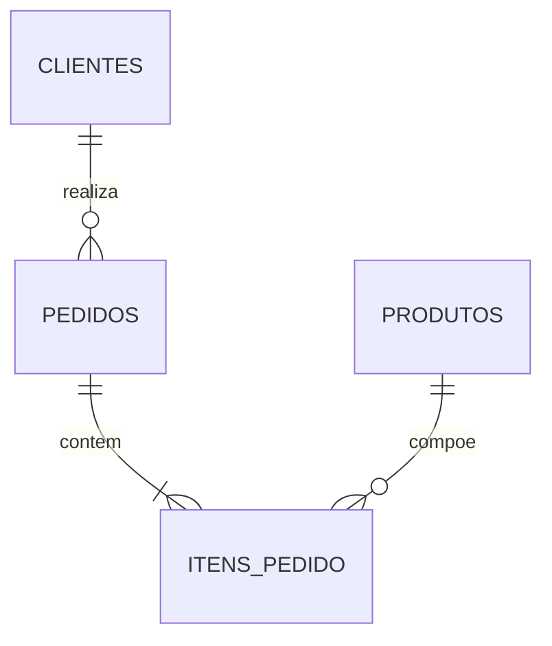

# Mini Loja Debiee

Aplicação em Python e SQLite para registrar pedidos de uma papelaria e
consultar as vendas pelo terminal. Os dados de exemplo são fictícios.

## Como executar

É necessário Python 3.10 ou superior. A aplicação usa apenas a biblioteca
padrão, sem pacotes adicionais ou servidor de banco de dados.

Baixe o ZIP do repositório, extraia a pasta e abra `iniciar.bat` no Windows.
Pelo terminal, dentro da pasta do projeto:

```powershell
py -3 -m src.main
```

No Linux ou macOS:

```bash
python3 -m src.main
```

Na primeira execução, o programa cria `data/loja.db` com a amostra. Os dados
são mantidos nas próximas execuções. O [manual de uso](COMECAR_AQUI.pdf)
traz uma sequência curta para testar o menu.

## Funções do menu

| Opção | Função |
| --- | --- |
| 1 | Resumo das vendas concluídas |
| 2 | Faturamento por cliente |
| 3 | Produtos por faturamento e estoque disponível |
| 4 | Faturamento mensal |
| 5 | Detalhamento dos pedidos, incluindo pendentes e cancelados |
| 6 | Clientes sem compras concluídas |
| 7 | Exportação dos relatórios para CSV |
| 8 | Cadastro de produto |
| 9 | Registro de pedido com baixa de estoque |
| 0 | Sair |

O CSV é salvo em `saidas/`, em UTF-8 e com separador ponto e vírgula. Os
valores usam vírgula decimal. Se o Excel abrir tudo em uma coluna, importe
o arquivo selecionando esse separador.

Também é possível executar um relatório sem abrir o menu:

```powershell
py -3 -m src.main --relatorio resumo
py -3 -m src.main --relatorio mensal --exportar saidas/mensal.csv
```

Os nomes disponíveis são `resumo`, `clientes`, `produtos`, `mensal`,
`pedidos` e `sem_compras`. Para trabalhar com outro banco, acrescente
`--banco data/ensaio.db`. A exportação pede um nome de arquivo que ainda
não exista.

## Banco de dados

O modelo tem quatro tabelas: `clientes`, `produtos`, `pedidos` e
`itens_pedido`. A tabela de itens relaciona os produtos a cada pedido.



As consultas usam duas visões: `vw_vendas_concluidas` e `vw_totais_pedido`.
Faturamento e ticket médio consideram somente pedidos concluídos. O
relatório de clientes mantém também quem tem total zero; o de produtos
inclui os itens que ainda não venderam.

Os preços são armazenados em centavos. Cada item mantém o preço da venda,
mesmo quando o preço atual do produto muda. O registro de um pedido e a
baixa de estoque ocorrem na mesma transação. Se um item não tiver saldo,
nenhuma parte do pedido é gravada.

## Resultados da amostra

A base inicial tem 8 clientes, 8 produtos, 12 pedidos e 21 linhas de itens.
Dos pedidos, 8 estão concluídos, 2 pendentes e 2 cancelados.

| Indicador | Valor |
| --- | ---: |
| Faturamento concluído | R$ 445,60 |
| Ticket médio | R$ 55,70 |
| Unidades vendidas | 36 |
| Clientes com compras concluídas | 5 |

As conferências por cliente, produto e mês estão em
[Resultados esperados](docs/RESULTADOS_ESPERADOS.md).

## Testes e arquivos

```powershell
py -3 -m unittest discover -s tests -v
```

São 31 testes de banco, consultas, cadastro, exportação e terminal. Eles
usam bancos temporários e não alteram os dados da aplicação. No Linux ou
macOS, substitua `py -3` por `python3`. O arquivo
`.github/workflows/testes.yml` executa a suíte no GitHub em Linux e Windows.

O código fica em `src/`, a estrutura e a amostra do banco em `sql/`, e os
testes em `tests/`. A documentação complementar está em `docs/`:

- [Modelagem e regras](docs/GUIA_DE_ESTUDO.md)
- [Requisitos do desafio](docs/CHECKLIST.md)
- [Validação](docs/VALIDACAO.md)
- [Repositório e entrega](docs/GITHUB_E_ENTREGA.md)

## Referência

Projeto do [Desafio Final de Engenharia de Dados Júnior](https://github.com/ckoliveiraa/Desafio-Final-Trilha-Engenharia-Dados-JR).
A implementação foi integrada à `main` pelo
[Pull Request #1](https://github.com/debieecrincev1/mini-loja-debiee/pull/1).
Código e documentação elaborados com apoio do ChatGPT.
